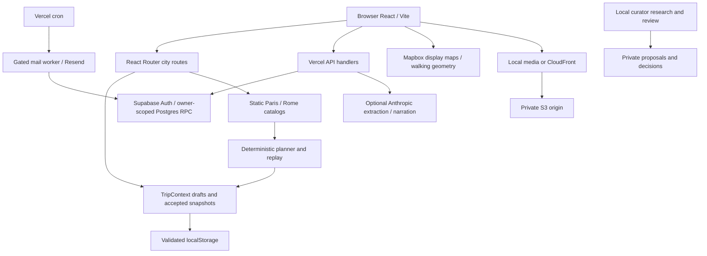

# 01 — Existing system audit

Audit date: October 11, 2026 (America/New_York). Repository HEAD: `e3e4e11`. Scope: local repository implementation and offline checks, not a certification of the current production deployment. All paths below are repository-relative. Proposed files in other documents are explicitly future work.

## Conclusion and inspection method

Copy My Trip is a substantial local-first itinerary application, with optional Supabase accounts/cloud copies, a separately gated email worker, development-only condition/alternative previews, an original Paris archive and a local curator research/review tool. It is a suitable foundation for Elsewhere. There is no cultural-work catalog, cross-media discovery service, cultural collection persistence or taste model today.

Inspected runtime entry points, route definitions, city interfaces and both city datasets; planner generation/replay and preset interfaces; local snapshots and cloud validation; account/API/SQL boundaries; media publisher, optimization and evidence tooling; curator proposal/review contracts; CSS and component composition; build scripts, Vercel and CDK configuration. Read README, Design.MD and the build-plan progression, using historical plans as context rather than evidence that features are currently activated. Did not read credentials, execute hosted mutation tests, send email, invoke paid models, publish media, apply migrations or deploy. No applicable repository AGENTS.md was found. Binary originals and the claimed worldwide archive were not exhaustively inspected. No fresh browser accessibility/mobile or hosted end-to-end certification is claimed.

## Architecture

Locked dependencies in `app/package-lock.json`: React 19.2.7, Vite 6.4.3, TypeScript 5.7.3, React Router 7.18.1, Supabase JS 2.116.0 and Mapbox GL 3.26.0. `app/package.json` also includes Anthropic SDK, Svix webhook verification and Vercel Analytics. `infra/package.json` declares CDK; it is a separate project. Preserve lockfiles rather than upgrade incidentally.

`app/src/main.tsx` creates a browser router inside CloudProvider and TripProvider. `components/Layout.tsx` resolves `:city`, supplies CityContext, renders navigation, storage warnings and Outlet. `TripContext.tsx` manages per-city working drafts, acceptance, recovery, copies and local proposal acceptance. `CloudContext.tsx` owns the optional account session. These are separate state boundaries, not a global database-backed application store.

Repository responsibilities: `app/src` browser/domain code; `app/api` seven Vercel handlers; `app/server` server helpers; `app/scripts` offline validation and operational tools; `supabase/migrations` four SQL migrations; `infra` media CDK; `build-plan` historical implementation records; `project` original design artifacts, not the active app.

### Routes and actual behavior

| Route | Current purpose / behavior |
|---|---|
| `/` | Redirect to `/paris` via DEFAULT_CITY |
| `/:city` | Editorial Home; only registered Paris/Rome accepted |
| `/:city/compose` | Date range, stay, pace, interests, optional brief interpretation and plan selection |
| `/:city/itinerary/:n` | Working itinerary, reconsider/remove/insert editing; cold load refuses to imply a composed trip exists |
| `/:city/saved`, `saved/:snapshotId` | Explicit acceptance, immutable version history, export, edit-copy and cloud panel |
| `/:city/saved/:snapshotId/briefing` | Accepted date-specific briefing; no regeneration |
| `/:city/today` | Destination-local before/during/after-trip views |
| `/:city/mail/:mailId` | Authenticated stored mail briefing |
| `/:city/archive`, `neighbourhoods` | Place map and neighborhood editorial content |
| `plans`, `build`, `day/:n` | Redirect to compose, itinerary/1, itinerary/:n respectively |
| `saved/:snapshotId/alternatives`, `weather-preview` | Development-only lazy routes; not public features |
| Invalid city/path | Redirect to default/city Home, not a meaningful content 404 |

Source: `app/src/App.tsx`. Hosting rewrites in `app/vercel.json` cover only `/paris/:path*` and `/rome/:path*`. Client-side route registration alone will not make new Elsewhere deep links work in production.

### APIs and external dependencies

| Handler | Responsibility / boundary |
|---|---|
| `api/extract-preferences.ts` | POST, bounded body, AI_ENABLED/key gate, Anthropic structured output; client `lib/extract.ts` validates city place IDs and inputs |
| `api/narrate-day.ts` | Optional streamed prose from supplied facts; output caps and incomplete-stream sentinel; prompts are not factual verification |
| `api/trips.ts` | Authenticated read/save/delete using validated snapshots and revisioned RPC |
| `api/account.ts` | Account lifecycle endpoint; SQL deletion requires recent password authentication |
| `api/notifications.ts` | Authenticated mail preferences and stored briefing operations |
| `api/companion-tick.ts` | Cron bearer-secret entry to mail worker |
| `api/companion-events.ts` | Raw-body Svix signature verification of Resend events |

`server/auth.ts` validates Supabase bearer tokens with Auth and requires verified nonanonymous email accounts. `server/trips.ts` calls PostgREST with the user's token and a publishable key. `vite.config.ts` installs `server/dev-trips.ts` for local cloud-related API handling; Vite alone does not implement the Anthropic functions. Mapbox tokens and Supabase publishable configuration are intentionally browser-visible; Anthropic, mail/cron/worker secrets are not.

No application-level shared quota/auth check is evident in the two AI handlers. Keep optional AI disabled for public expansion until server-enforced spend controls exist. The narration prompt uses a seasoned traveler's voice even for researched places; reuse the narrow boundary, not an assumption that prompt instructions guarantee provenance.

## Feature inventory

“Working” here means a traced implementation, with offline evidence where listed. It does not mean its external account is enabled today.

| Feature | Implementation location | Maturity | Dependencies | Recommendation |
|---|---|---|---|---|
| City catalog and cross-reference validation | `src/cities`, `scripts/validate-city.ts` | Working for two cities | Static JSON, TypeScript | Preserve planner contracts |
| Deterministic generation and editable days | `lib/planner.ts`, `lib/plan-presets.ts`, `pages/ItineraryPage.tsx` | Working; invariant harness passes | City hours, variants, day context | Preserve |
| Curated days | Paris `curated-days.json`, `lib/built-day.ts` | Partial catalog linkage | Place IDs and plates | Extend through reviewed data |
| Preference extraction | `api/extract-preferences.ts`, `lib/extract.ts`, `ComposePage.tsx` | Implemented, optional/config-gated | Anthropic | Extend with separate discovery contract |
| Narration | `api/narrate-day.ts`, `lib/narrate.ts` | Implemented, explicit optional action | Anthropic | Preserve; tighten provenance/cost controls |
| Local persistence/recovery | `lib/trips/local-store.ts`, `TripContext.tsx` | Implemented, bounded/validated | Browser storage, Web Locks for proposal acceptance | Preserve keys and format |
| Frozen accepted snapshots/replay | `lib/trips/schema.ts`, `snapshot.ts`, `planner.ts:replayDay` | Implemented | Release compatibility | Preserve exactly |
| Accounts/private cloud copies | `CloudContext.tsx`, `CloudSavePanel.tsx`, API, migration 001 | Implemented; historical live evidence | Supabase configured | Extend same auth identities |
| Recovery/account deletion | `AccountRecovery.tsx`, `AccountDeletion.tsx`, migration 002 | Implemented; historical delivery evidence | Supabase SMTP/Auth | Preserve; add deletion coverage for new tables |
| Today/briefing/export | pages and `lib/briefings/*` | Implemented | Accepted snapshot, IANA zone | Preserve |
| Scheduled email | `server/companion/jobs.ts`, APIs, migration 003 | Gated pilot implementation | Cron, database controls, Resend | Keep separate from discovery rollout |
| Weather | `lib/conditions`, `server/conditions`, migration 004 | Preview/shared-cache code, deployment unverified | Provider rights/config, cache | Defer activation |
| Closure alternatives | `lib/proposals`, `AlternativesPreviewPage.tsx` | Development-only local simulation | Deterministic engine, exact acceptance | Reuse concepts, not claim cloud proposals exist |
| Archive/provenance | City media/slots/dates; evidence scripts | Working tooling with unresolved evidence gaps | Original files, ffprobe | Extend |
| Responsive images/video | `ImageSlot.tsx`, `HeroPhoto.tsx`, `responsive-media.ts`, `video-director.ts` | Implemented | Generated variants, local assets | Preserve, reconcile CDN path strategy |
| Maps | `TripMap`, `ArchiveMap`, `RouteMap`, `map-route.ts` | Implemented, schematic fallback | Mapbox optional | Extend display-only atlas |
| Curator review | `scripts/review/*` | Local research/review pilot, no publisher | Private run files, OpenAI live research | Adapt atomic claim review |
| Analytics | `WebAnalytics.tsx`, `lib/analytics.ts` | Implemented, hosted receipt unverified | Vercel | Extend redaction allowlist |
| Cultural graph, library, taste profile | No implementation found | New | Proposed schema/services | Build incrementally |

## Existing contracts and data realities

### Catalog

`City` in `src/cities/types.ts` is a planner aggregate: timezone, start location, day bounds/templates, places, nodes, neighborhoods, media, slots and dates. `CITIES` statically imports Paris and Rome; city registration still requires a module and registry change. It is not a country/city/neighborhood ontology.

Counts computed from current JSON: Paris 127 places, 33 `src:verified`, 4 curated days, 11 neighborhoods, 37 media-description entries and 114 filename-to-month date records. Rome 42 places, zero verified, zero curated days, 8 neighborhoods, 42 media-description entries and zero date records. A media-description entry is not a photograph. Three Paris curated stops currently lack placeId: Café de la Mairie, Quai de Montebello and Le Bon Georges. Resolve these with curator review; do not manufacture IDs or linkage from similar names.

`Place` uses city-local ID, lat/lon, hood, group, duration, opening windows, optional weekly hours/date exceptions and `src:verified|web`. Experiences can override provenance and duration separately from their parent. Coordinates are lat/lon objects; map GeoJSON uses `[lon,lat]`, and the decorative river uses `[lat,lon]`. Test adapters explicitly. Existing six planner themes are scheduling categories, not an adequate cultural taxonomy. City imports use TypeScript assertions over JSON, so the runtime `validate:cities` gate is essential; compile success alone does not prove data validity.

Retain `Place`, `Experience`, `City`, and existing JSON unchanged for MVP. Add cultural geographic records and an explicit `(cityId, placeId, experienceId?)` mapping outside City. `visits`/`last` and binary src are legacy editorial fields, not a complete evidence ledger. New evidence must not automatically promote them.

### Archive

`Plate` contains id, dimensions, caption and optional video; `PlaceMedia` provides descriptions/plates/provenance text. `slot-files.json` resolves presentation slots to filenames; `media-dates.json` stores only YYYY-MM. `scripts/archive-files.ts` reads EXIF/QuickTime/GPS and maps derived video frames to masters. EXIF wall time is not proven UTC. The public city contract has no asset ownership, license, visibility, sensitive-coordinate classification, claim-specific review or revocation model.

`media:manifest --check` reports 94 runtime allowlisted files in Paris totaling 299.6 MiB. It is not an inventory of 50 countries or proof that every source is safe to publish. `optimize-media.mjs` writes content-hashed WebP variants, while `publish-media.ts` copies allowlisted JPEG/MP4 files to S3 and does not publish that WebP tree. `responsive-media.ts` returns same-origin `/media/optimized/...` paths even for a CloudFront original URL. `.vercelignore` currently leaves `public/media/**` commented out. This dual-delivery arrangement must be retained or deliberately reconciled, not silently “cleaned up.”

### Drafts, dates and acceptance

`TripState` (`state/TripContext.tsx`) stores dates, pace, interests, stay, seed, extracted preferences, seven working day slots, per-day pace/purpose/context, release and narration. `ExtractedPrefs` permits bounded thematic weights and include/avoid requests referencing catalog IDs; it does not carry a schedule.

`SNAPSHOT_SCHEMA=1`, `PLANNER_VERSION='local-companion-1'`. `PlanSnapshot` freezes accepted schedule, display facts, evidence labels, image URLs, source, timings, warnings and release. `validateSnapshot` checks draft/day/stop consistency. `replayDay` retains timing intent, waits and return legs; a list of IDs is not equivalent. `catalogVersion(city)` hashes the entire City object; `canEdit` requires exact engine and catalog equality. New editorial fields inside City would invalidate editing compatibility even if no hours changed. Frozen display remains readable for a supported snapshot schema; arbitrary future schema versions are rejected with recovery, not automatically rendered.

`plannedDays` supports one to seven overnight days, excludes checkout, and `dateInZone` uses an IANA timezone. Do not turn “Lisbon next month” into invented exact travel dates. Seeded generation is deterministic for fixed inputs and versions; initial draft seed may vary by creation time.

`cmt-local-companion-v1` localStorage contains schema 1 drafts and up to 20 accepted versions, with a 3,000,000 character bound. Legacy `cmt-trips-v3` is offered for explicit draft recovery. Failed/corrupt storage is preserved; intentional reset/import uses the existing recovery flow. Local data is origin-scoped and does not follow a domain redirect.

### Cloud and account ownership

`lib/cloud/schema.ts`: maximum 1,500,000-byte request, one to eight ordered/non-overlapping city segments, expectedRevision, immutable-version collision checks and session fencing. SQL migration 001 defines owner-scoped `cmt_trips`, `cmt_trip_segments`, `cmt_plan_versions`, SELECT RLS, restricted writes through RPC, account locks, immutable version checks and tombstones. It explicitly restricts snapshot city IDs and zones to Paris/Rome. Preserve these tables/RPCs while adding culture tables.

Authentication is email/password with nonpersistent in-memory sessions (`lib/cloud/client.ts`). Cloud copies are explicit; downloaded local copies deliberately survive sign-out. No account migration is needed to introduce owner-scoped cultural collections. New tables must cascade with account deletion and never treat caller-supplied owner IDs as authority.

Migration 003 adds mail control, suppression, preferences, jobs/events and deletion handling; migration 004 adds leased weather cache/control. File existence does not establish that either is applied to a live project.

## Design system and reuse

Actual CSS wins over Design.MD. `main.tsx` imports fonts, classical, app, then editorial CSS. Current tokens use Newsreader headings, Inter body, JetBrains Mono metadata; background `#fbf9f6`, ink `#0f172a`, accent `#c2410c`. Fonts are self-hosted WOFF2 with licenses. Editorial Home uses framed imagery, large serif headings and researched-only Rome treatment. Reuse Page, ImageSlot/HeroPhoto, timeline, map panel, date picker, account controls and snapshot UI. Avoid exporting planner-specific CandidateCard scoring language to cultural recommendations.

Responsive rules stack around 760px with additional map/layout breakpoints. Existing skip link, aria-current, focus-visible, status/alert patterns, reduced-motion rules and keyboard map markers are valuable. CSS/source and render tests do not establish contrast, focus restoration, modal behavior, screen-reader clarity or touch usability. Verify those on the new flows and current DateRangePicker/CitySelector. Keep textual list equivalents to maps; never express provenance only with color or filled/hollow dots.

## Deployment, tests and operational gaps

Vercel project root must remain `app`; output is `dist`. Build runs frontend TypeScript, API TypeScript, API runtime checks and Vite. Cron is configured every five minutes; sending additionally requires explicit environment/database controls. Live plan/cron eligibility, environment values and migration state were not inspected. No checked-in GitHub Actions workflow was found; package scripts are available gates, not proof CI runs them.

CDK uses private S3, CloudFront OAC, TLS, public CDN reads, bucket versioning/retain and termination protection. Noncurrent versions expire after 90 days. That is useful resilience, not an independent archive backup. Public CDN access is not private viewer authorization. `--delete` is opt-in in the publisher; never use it as part of this transition.

Current verification results and environmental limitations are recorded in the final section below. Hosted Auth/RLS, delivered mail and browser checks in plans 13–25 are historical evidence, not rerun acceptance. Database test scripts can create/drop disposable databases; none were pointed at any database during this assignment.

## Documentation discrepancies requiring reconciliation

| Documentation assertion | Source-based correction |
|---|---|
| README initially says cloud is not connected; later says launched | Code implements cloud; historical launch records exist. Current hosted state remains unverified |
| README says only two API routes and no sent email | Seven handler files and gated mail infrastructure exist; pilot delivery recorded in plan 17 |
| Design.MD says Paris 121/23, serif Lora/Cormorant, gold/gray, measured verified walks | Current JSON is 127/33; Newsreader/Inter/rust/ivory; `planner.ts` explicitly makes heuristic travel `measured=false` |
| Old curated-day plan lists eight unlinked stops | Current data has three; do not re-open resolved items indiscriminately |
| README suggests city addition is only JSON | Registration/module plus hosting rewrites and cloud SQL restrictions also matter |
| README curator section says live measurements pending | Plans 08–09 record automated research/review; independent factual accuracy, manual time and final cost still unmeasured |
| Original-cloud-media instructions imply all runtime media can move together | Optimized display assets currently use same-origin paths and a separate manifest |

## Prioritized findings

Highest priorities are snapshot/catalog compatibility, origin-bound local data during any domain change, privacy of media under public paths, rights-safe enrichment, and source evidence separate from editorial judgments. Next are hosted route rewrites, new table RLS/deletion, public AI quotas, deployment-state drift and performance as static imports grow. The ranked register and owners are in [08](08-risk-register.md).

## Verification ledger for this audit

Executed using Node v22.20.0 from `app/` on the local checkout. All tests below are existing repository commands; no new product tests/features were implemented in this planning assignment.

| Command | Observed result and scope |
|---|---|
| `npm run validate:cities` | Pass for both cities; internal consistency, not external factual accuracy |
| `npm run smoke:plans` | Pass; generated-plan constraints, edits/pins, replay and cross-timezone determinism |
| `npm run smoke` | All 19 route render/redirect checks pass; server rendering, not interactive browser E2E |
| `npm run test:companion` | 16 pass; accepted facts, waits/returns, local recovery, calendar, provenance and escaping |
| `npm run test:cloud` | 10 pass after permitted localhost rerun; initial sandbox EPERM on 127.0.0.1 was environmental; mocked application boundaries, not hosted RLS |
| `npm run test:review` | 21 pass; frozen proposals, source claims, decisions, retries and local review API; no live research |
| `npm run test:mail` | 11 pass; fixtures, cron gates, signatures/idempotency, no real send |
| `npm run test:weather` | 8 pass; mocked provider and expiry behavior |
| `npm run test:weather:mail` | 7 pass; leases, cached preparation and accepted-fact preservation |
| `npm run test:proposals` | 14 pass; bounded alternatives, exact acceptance, stale/tampered rejection |
| `npm run test:analytics` | 11 URL-redaction checks pass |
| `npm run test:map-media` | Pass; route returns/transit separation, request limits/cache/fallback and 74 responsive-image sets |
| `npm run smoke:media-url` | 3 pass |
| `npm run media:manifest` | Report-only check passes: 94 files, Paris, 299.6 MiB; no upload |
| `npm run media:audit` | Report completed, exit 0; eight findings across 114 files and 127 places; report-only, no corrections applied |
| `npm run archive:evidence` | Report completed, exit 0; 114 dated files, 86 with coordinates, 25 places with temporal evidence, 18 review proposals; no data written |
| `npm run build` | Pass: frontend/API TypeScript, unbundled API runtime smoke and Vite; 181 modules transformed |

Vite warnings: index chunk 647.46 kB (197.81 kB gzip) and Mapbox chunk 1,859.16 kB (518.66 kB gzip); lazy loading affects whether each is initially requested. This is build output, not a measured page-load benchmark. The source/tests report 91% fewer bytes for largest variants across 74 responsive images, not a universal end-user speed claim.

The archive report flags metadata/catalog disagreements and distant viewpoints; it must not be used to automatically change recommendations, visit counts, experience provenance or pins. `ffprobe` is available and the report completed. Precise private metadata was not copied into these planning documents.

Not run: hosted cloud/email/live-pilot scripts; database-creating smoke scripts; media optimization/publishing; CDK synth/deploy; new browser end-to-end interaction. Existing tests exercise behavior beyond a build, but deployed configuration, real provider access, current commercial eligibility, full accessibility and production recovery remain external acceptance tasks.

A `git status` attempt encountered a filesystem read/index error (`Operation canceled` on `app/scripts/media-audit.ts`) in this iCloud-backed checkout. Do not interpret it as a clean-working-tree assertion or a product test failure. This assignment's authored deliverables are the ten Markdown files under `docs/elsewhere`; test/build commands also generated their usual ignored build/temp outputs. No source correction or catalog edit was made.
