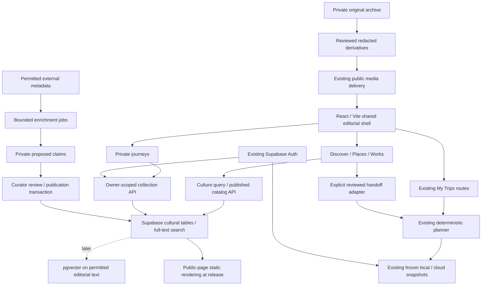

# 06 — Target architecture

Keep React/Vite, TypeScript, React Router, Supabase Auth/Postgres, Vercel APIs and the existing S3/CloudFront delivery investment. Build an additive cultural domain. No Next.js migration, separate graph database, vector vendor or agent framework is justified by the inspected implementation.

## Frontend and public content

`App.tsx` gains a global shell and explicit route families; current city routes remain under their CityContext adapter. Avoid a wholesale state reorganization. Discovery search state lives in route params or local component state; private collection state has its own provider/cache and session fence. Query strings can contain interests: strip them from analytics and do not put private notes in URLs. Do not use TripContext as a universal entity store.

Current `CITIES` eagerly imports both full catalogs and the display variant manifest. Fine for two cities, expensive for 50. Do not add 50 full planner bundles. Public culture endpoints return bounded projections/pagination; load planner catalogs only for supported cities when measured bundle size warrants it. Delay that refactor until preservation fixtures are in place. Mapbox stays dynamic where already used; maps are optional display features and do not supply accepted schedule times.

The SPA's client document.title is insufficient for reliable public social cards and first-response metadata. For MVP public destination/work/editorial pages, add a bounded build-time static rendering step from the approved release manifest using the existing React components or a small template adapter. Emit correct title, description, canonical, share image, visible content, sitemap and structured data only for supported factual types. New published content triggers a controlled rebuild; private journeys/trips remain unindexed SPA routes. Ensure generated HTML and client data identify the same content revision to avoid hydration mismatch. Test content and status in raw HTTP responses, not only a browser.

If publication frequency, page count, personalization or rebuild latency makes static generation inadequate, benchmark an isolated SSR public surface versus a framework migration. Decide on measured indexing and operational needs; do not move planner state just to gain metadata tags. Vercel rewrite specificity must preserve generated files and API functions before SPA fallback. Unknown public entity pages need genuine 404 handling.

## Persistence and permissions

Add migrations in dependency order: catalog/evidence/geography → publications/search projections → owner collections/states → jobs/review → optional embeddings. Use `ew_` names and keep existing cmt SQL unchanged except explicitly reviewed future additions to planner city support. No bulk rewrite of accepted JSON.

| Boundary | Policy |
|---|---|
| Public catalog | Read only published, permitted projections; private source payloads and rejected claims have no public grants |
| Private journeys/states | `auth.uid() = owner_id` on SELECT/INSERT/UPDATE/DELETE, WITH CHECK on writes; owner immutable; child ownership enforced by composite FK or transaction |
| Collection references | Can reference only published entities or retained withdrawn stubs; must not reveal private collections belonging to others |
| Reviewer | Server-owned role assignment; user-editable profile metadata never grants curator privileges |
| Publication | Dedicated server/RPC permission; expected revision, full validation and audit in one transaction |
| Jobs and original metadata | No browser grants; scoped worker functions and strict action allowlists |
| Account deletion | FKs cascade all new private data; cancel user jobs and invalidate private caches; document backup expiry |

Use the existing bearer authentication and publishable-key/user-token pattern (`server/auth.ts`, `server/trips.ts`). Do not introduce a service-role key into the browser. Public read APIs are distinct from owner-specific search exclusions; personalized responses use `private,no-store` and never share public CDN cache entries. Test RLS directly through PostgREST as well as through the API.

Collections use expectedRevision and stable mutation IDs. Exact retries succeed without duplicates; same mutation ID/different content fails. Conflict response returns a safe code/current revision, not another user's data. Deletes leave minimal tombstones if needed to prevent delayed resurrection. Do not reuse `CloudTrip` for collections: its ordering, segment count and accepted-snapshot requirements mean something different.

## Proposed API contracts

All versioned contracts include bounded input validation, request IDs and safe errors. Paths are proposed under existing `app/api`, with routing conventions verified in a preview before implementation is considered done.

| Endpoint | Input/output and authorization |
|---|---|
| `GET /api/catalog?kind=destination|work&id=...` | Public published DTO + revision/evidence summary/attribution; 404 for missing/unpublished; bounded cache by publication revision |
| `POST /api/discover` | `DiscoveryQueryV1` → result IDs, qualified relations, explanation claim IDs, applied filters, unsupported dimensions, cursor, catalog revision; optional verified account for private exclusions; no source ingestion in request path |
| `POST /api/interpret-discovery` | `{text<=1200, locale, clientDate, timeZone}` → editable proposed query + ambiguities; optional AI feature flag, timeout, quota; no catalog writes |
| `GET/POST /api/collections` | Authenticated list/read or create/update/remove with expectedRevision and mutation ID; bounded item count/notes, no caller-controlled owner |
| `POST /api/work-state` | Authenticated work-level consumed/hidden/interested change, revision; no automatic rating inference |
| `POST /api/planner-handoff` | Reviewed selected relation IDs + destination → allowed planner inputs, catalog release, unsupported items/reasons; never calls acceptSnapshot |
| Internal review endpoint/CLI | Frozen proposal ID + expected entity revision + explicit decisions → audited publication result; curator-only, separate from public APIs |

`DiscoveryQueryV1`: optional geographic IDs with allowed relationship types; media kinds; theme IDs; setting period and release period separately; fiction filter; language; optional territory/availability; excludeConsumed; limit <=20 and opaque cursor. Hard filters cannot be relaxed by the LLM. Define unknown-setting policy explicitly: strict modern-setting requests exclude unknown periods and offer them only in a separate optional section.

## Search and recommendation execution

1. Validate structured query and authorizations. Interpret free text only if requested; user-visible dimensions are authoritative.
2. Apply publication/rights filters, work kind, geography predicate, setting era, language and consumed/hidden exclusions.
3. Retrieve title/alias and weighted editorial full-text matches. At MVP scale use Postgres tsvector with GIN; retain deterministic curated rankings for cold start.
4. Later retrieve permitted embeddings under the same eligibility filter; fuse ranked lists and deduplicate canonical works. Version model/dimensions; do not mix incompatible vector spaces.
5. Rerank using explicit interest weights, evidence quality and diversity caps (avoid ten editions or a single creator dominating). Unknown evidence cannot win a certainty claim.
6. Return evidence-linked explanations from templates; optional LLM restyling receives only allowed claims and is discarded if it introduces unsupported entities/relations. Template explanations are the fallback.

Supabase documents combining tsvector and pgvector in Postgres; this makes a second search service unnecessary initially. The recommendation to postpone vectors until measured gain is a project-specific decision, not a platform limitation. [Supabase hybrid search](https://supabase.com/docs/guides/ai/hybrid-search).

LLMs are useful for query interpretation, candidate annotation and wording proposals. Entity ownership, filters, revision checks, publication rights, planner feasibility, dedup identity decisions and accepted snapshots remain deterministic/reviewed. No model is called on restoration, ordinary page render or nightly itinerary assembly.

## Background enrichment and review

Start with a local CLI for the reviewed seed batch, adapting the existing private review tool. When refreshes need unattended execution, add an `ew_enrichment_jobs` Postgres queue with job type, entity/source version, unique idempotency key, state, attempt count, next_attempt_at, lease token/expiry, budget reservation and result/proposal reference. A short authenticated worker claims a bounded batch transactionally (skip locked), performs external IO outside the lock, and commits only if its lease/version remains current.

Retry transient timeouts/429 with jitter and a small attempt cap; permanent rights/schema errors go to review/dead-letter. A crash can duplicate external reads but cannot duplicate publication. Expired leases resume safely. No task executes arbitrary source instructions, tools or URLs: allowlist providers, block private-network fetches, cap response sizes, and treat retrieved text as data. Redact credentials and private GPS from logs and prompts.

A distinct enrichment tick may use existing hosting after cron/runtime entitlement is verified. Do not overload `companion-tick` or share its mail controls. Add SQS/another queue only if backlog/throughput/lease reliability measurements justify it. Long archive scans stay local initially; never cram them into a request timeout.

## Media, observability and costs

Keep existing public media stack; resolve the Vercel-optimized/CDN-original split explicitly before broadening publication. Build private original storage only when inventory demands it, outside the public distribution. Preserve original URLs and the separate display manifest. See [04](04-archive-integration.md).

Record query version, catalog revision, result IDs, claims used, model/adapter versions, latency stages, token counts, estimated and reconciled spend, cache hits, queue age, retries and curator approval rate. User text is not default telemetry. Keep a synthetic evaluation corpus and sampled consented/redacted debugging records. Trace from recommendation to claim to source receipt and reviewer. Alerts: publication without evidence, rights expiry, job backlog, spend ceiling, RLS violations, unexpected AI request volume and lost static-content freshness.

Cost model: existing hosting/database baseline + object storage/egress + Mapbox loads/directions + provider licenses + model tokens + reviewer time. No new paid service is activated here. Exact account invoices/quotes were not read; budget before enabling. Initial experiments can have explicit ceilings (proposed $10/day enrichment, $0.05/query model spend, owner-selected monthly cap), with hard reservation/stop logic and offline/manual alternatives. These are budgets, not claims about current provider prices. Licensed-provider quotes can dominate model costs.

## Explicit technology decisions

| Change | Justification / trigger |
|---|---|
| Keep React/Vite/Router and TypeScript | Existing working flows, CSS and test investment |
| Add culture tables/RPCs in existing Supabase | Shared auth and manageable relational evidence; no account migration |
| Add Postgres FTS initially | Sufficient for curated catalog and deterministic filters |
| Optional pgvector later | Only if held-out evaluation improves relevance within latency/cost targets |
| Small static public-page generation | SEO/social metadata without moving planner to Next.js |
| Extend local review CLI; later Postgres job leases | Reuse provenance and bounded worker pattern with little operational overhead |
| Retain S3/CloudFront; private originals separated if required | Existing investment, clear public/private access boundary |
| No new graph database, Redis, vector SaaS, autonomous planner or agent framework | No demonstrated MVP requirement |
